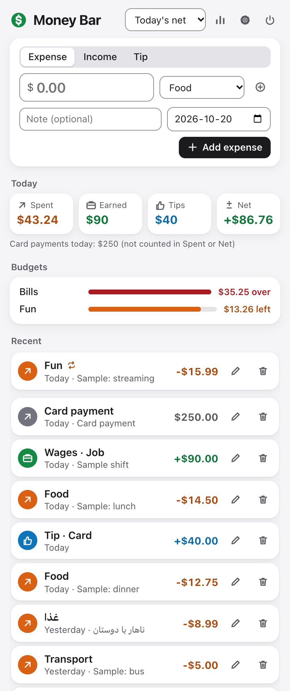
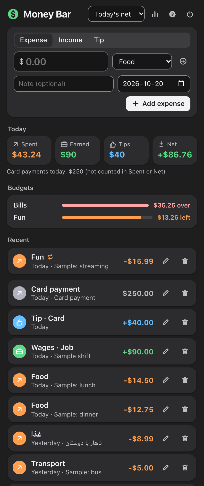
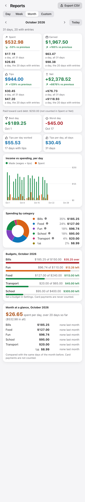
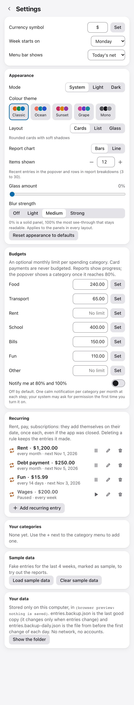

# Money Bar

[](https://github.com/RezzAk47/money-bar-cross/actions/workflows/ci.yml)


[](LICENSE)

**Track what you spend, earn and get in tips, right from your tray.**

Money Bar is a small tray / menu-bar app for Windows, Linux and macOS. Add an expense, income or tip in a few keystrokes, see
today's totals and your budgets at a glance, and open reports, recurring entries and CSV export when you need them. Built with
Tauri 2 (Rust) and Preact. It is the cross-platform sibling of the SwiftUI Mac app
[money-bar](https://github.com/RezzAk47/money-bar) and reads and writes the same `entries.json`.

| Popup, light | Popup, dark | Report | Settings |
|---|---|---|---|
|  |  |  |  |

<sub>Screenshots use the app's own made-up sample entries. More in the [gallery](docs/GALLERY.md).</sub>

## Features

- Quick add for expenses, income and tips, with categories, notes and dates.
- Today's spent, earned, tips and net, plus card payments shown apart.
- Monthly budgets per category (set in Settings, or click a category in Reports), with optional alerts at 80% and 100% (off by
  default).
- Reports by day, week, month or a custom range: bars or line, donut and month-at-a-glance.
- Recurring entries, custom categories, your own currency symbol, CSV export.
- Light and dark, colour themes, three layouts (Cards, List, Glass), start at login. Keyboard friendly and right-to-left safe.

## Download

Installers will be on the [Releases](https://github.com/RezzAk47/money-bar-cross/releases) page (coming soon). Until then,
[build from source](#build-from-source).

The builds are not code-signed, so Windows SmartScreen and macOS Gatekeeper will warn the first time you open the app.

## Platform support

| | Windows | Linux | macOS |
|---|---|---|---|
| Installer (when released) | `.exe` (NSIS), x64 | `.deb` and `.AppImage`, x86_64 | `.dmg`, Apple silicon and Intel |
| CI build and tests | Passing | Passing | Passing |
| Installer smoke test (installs and starts) | Passing | Passing | Passing |
| Tested by hand | Not yet | Not yet | Yes |
| Text next to the tray icon | Tooltip only | Tooltip only | Yes |
| Open the popup | Click the tray icon | Tray menu, "Show Money Bar" | Click the menu-bar icon |

On GNOME the AppIndicator extension is needed. Details in
[docs/DETAILS.md](docs/DETAILS.md#known-limits-and-differences-from-the-mac-app).

## Privacy

| What | Details |
|---|---|
| Reads and stores | Only your own entries, in `entries.json` (plus backups) in the app's data folder on your computer. |
| Network | None. The app makes no network requests and its window cannot load anything remote. |
| Leaves your computer | Only a CSV file, when you export one yourself. |
| Never | No analytics, no telemetry, no account. |

Where the data folder is and how saves are protected: [docs/DETAILS.md](docs/DETAILS.md#where-the-data-lives). Money Bar is
not financial advice or accounting software.

## Build from source

Needs Node 24+, Rust 1.90 or newer, and the [Tauri 2 prerequisites](https://v2.tauri.app/start/prerequisites/) for your
system (on Linux: WebKitGTK 4.1 and an AppIndicator library, see `.github/workflows/ci.yml`).

```sh
git clone https://github.com/RezzAk47/money-bar-cross.git
cd money-bar-cross
npm ci --ignore-scripts
npm run tauri build          # installer for this OS, in src-tauri/target/release/bundle
npm run tauri dev            # or run it in development mode
```

Build with `npm run tauri build` (or `tauri dev`), not a plain `cargo build`: a plain cargo build does not embed the page and
the window stays blank.

Tests:

```sh
npm test && npx tsc --noEmit
(cd src-tauri && cargo test --locked && cargo clippy --all-targets -- -D warnings)
```

More checks (UI smoke test, screenshots, a run against a temp folder, the self test) are listed in
[docs/DETAILS.md](docs/DETAILS.md#all-checks).

## Status

Early (v0.1.1). Developed and used on macOS. CI passes on Windows, Linux and macOS, and the installers install and start in an
automated test on all three, but nobody has used the Windows or Linux builds by hand yet. Known limits and differences from
the Mac app are in [docs/DETAILS.md](docs/DETAILS.md#known-limits-and-differences-from-the-mac-app).

## Credits

A port of the SwiftUI Mac app [money-bar](https://github.com/RezzAk47/money-bar), with the same file format.

Third-party components and trademark notes: [THIRD-PARTY-NOTICES.md](THIRD-PARTY-NOTICES.md) (full licence texts in
[THIRD-PARTY-LICENSES.txt](THIRD-PARTY-LICENSES.txt)).

## License

MIT. See [LICENSE](LICENSE).

## Contact

Questions or a security problem: rzk.karimi@gmail.com (see [SECURITY.md](SECURITY.md)).
